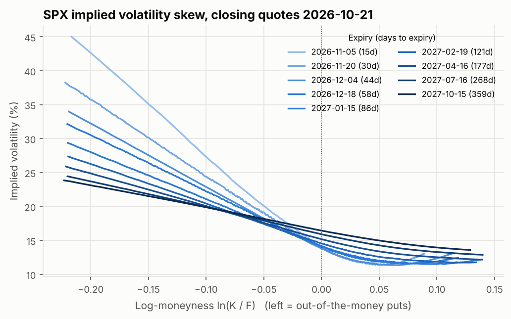
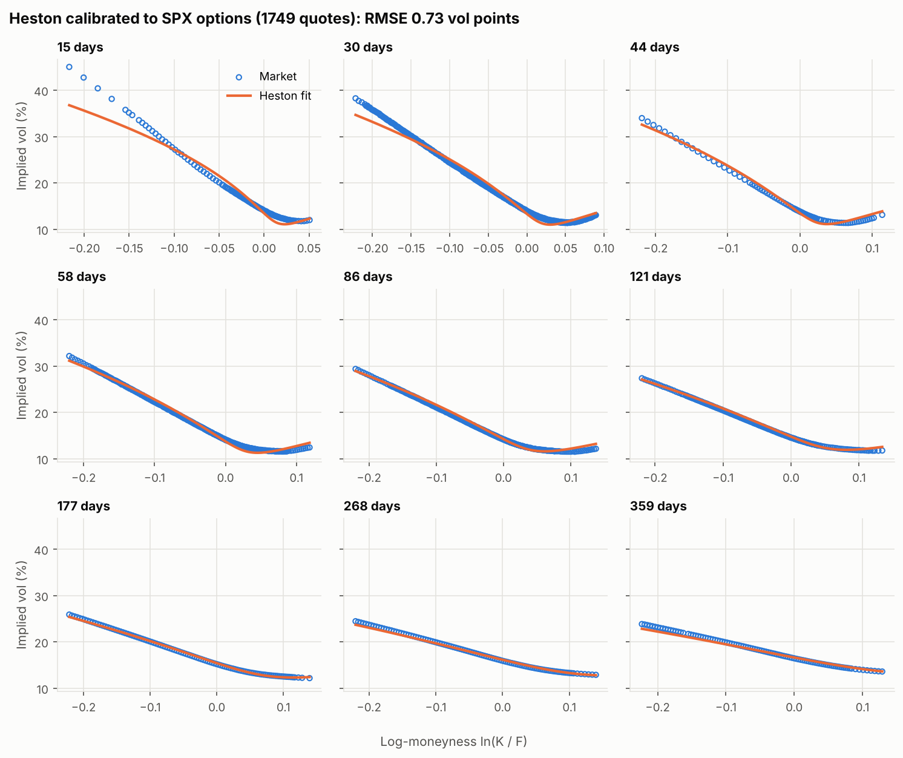
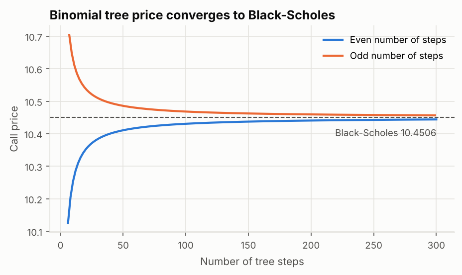
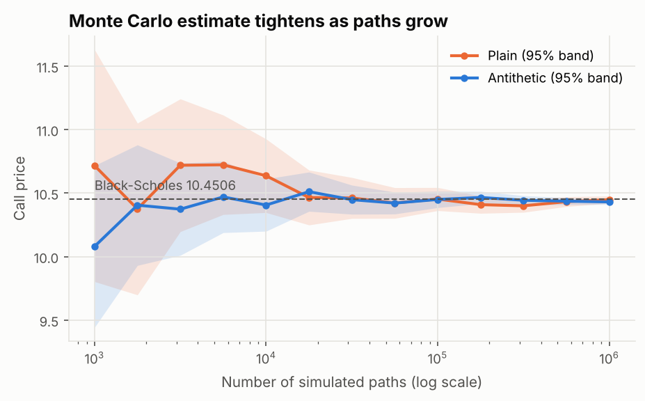
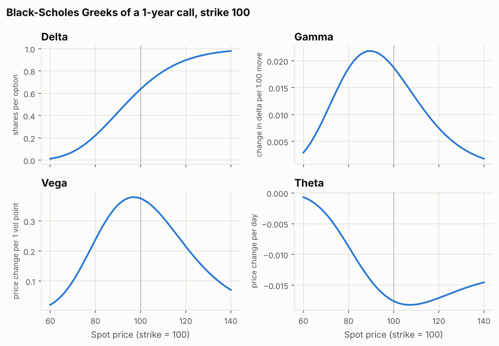
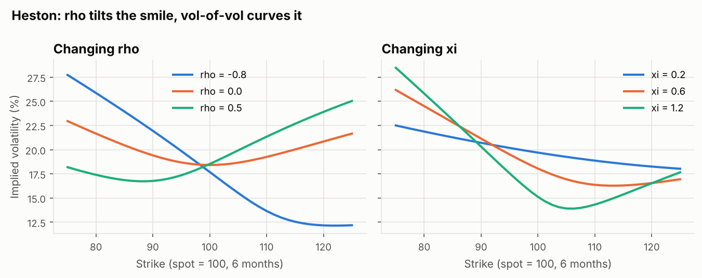

# Option Pricing Models

Black-Scholes, binomial-tree, Monte Carlo and Heston stochastic-volatility pricers written from scratch in Python, with the Heston model **calibrated to real S&P 500 index (SPX) option prices**. Every model is checked against the others in an automated test suite.

<!-- RESULTS:START -->
**Latest calibration** (SPX quotes at the 2026-10-21 close, spot ≈7,687 (estimated from the nearest forward), 1749 out-of-the-money quotes across 9 expiries, prices from bid-ask mids):

| v0 | kappa | theta | xi (vol of vol) | rho | Fit RMSE | Feller 2κθ > ξ² |
| --- | --- | --- | --- | --- | --- | --- |
| 0.0239 | 8.879 | 0.0403 | 2.058 | -0.683 | 0.73 vol pts | not met |

Spot volatility √v0 = 15.5%, long-run volatility √θ = 20.1%.

| Days to expiry | Quotes | Forward (from put-call parity) | Fit RMSE (vol pts) |
| --- | --- | --- | --- |
| 15 | 121 | 7,700.1 | 1.66 |
| 30 | 355 | 7,709.5 | 1.01 |
| 44 | 97 | 7,717.7 | 0.65 |
| 58 | 337 | 7,727.7 | 0.51 |
| 86 | 307 | 7,756.5 | 0.40 |
| 121 | 222 | 7,783.5 | 0.32 |
| 177 | 105 | 7,830.4 | 0.20 |
| 268 | 105 | 7,913.3 | 0.31 |
| 359 | 100 | 7,999.5 | 0.47 |




<!-- RESULTS:END -->

## What's inside

| Module | What it does |
| --- | --- |
| `src/black_scholes.py` | Black-Scholes-Merton prices and Greeks (delta, gamma, vega, theta, rho), vectorised over strikes |
| `src/binomial.py` | Cox-Ross-Rubinstein tree for European and American options |
| `src/implied_vol.py` | Implied volatility by Newton-Raphson with a Brent fallback and no-arbitrage bound checks |
| `src/monte_carlo.py` | Monte Carlo under GBM (antithetic variates, 95% intervals) and under Heston (full-truncation Euler) |
| `src/heston.py` | Heston characteristic function ("little trap" form) and Lewis (2001) Fourier pricing integral |
| `src/market_data.py` | Cleans an SPX option chain: mid prices, forwards from put-call parity, out-of-the-money filter, implied vols |
| `src/calibration.py` | Fits the 5 Heston parameters by vega-weighted least squares from several starting points |
| `scripts/fetch_spx_chain.py` | Downloads an SPX option-chain snapshot and the 13-week T-bill rate (yfinance) |
| `scripts/run_all.py` | Rebuilds every figure in `figures/` and every number in `results/` and this README |

## Quick start

```bash
pip install -r requirements.txt
pytest                              # 135 checks
python scripts/fetch_spx_chain.py   # optional: today's market (best during US market hours)
python scripts/run_all.py           # figures, calibration, results
```

## Validation

The models are tested against each other rather than trusted individually:

- Black-Scholes reproduces the textbook values (call 10.4506, put 5.5735 for S = K = 100, T = 1, r = 5%, σ = 20%), satisfies put-call parity to 1e-10, and every Greek matches a finite-difference derivative.
- The binomial tree converges to Black-Scholes; the American put is worth more than the European; the American call without dividends equals the European.
- Implied vol recovers the input volatility to 1e-6 across strikes, maturities and vols from 5% to 150%.
- Monte Carlo brackets the exact price in its 95% interval, antithetic variates cut the error, and the error falls like 1/√N.
- Heston: the characteristic function satisfies φ(0) = 1 and E[S_T/F] = 1; the Lewis integral reproduces Black-Scholes exactly when given the Black-Scholes characteristic function; Heston with no vol-of-vol equals Black-Scholes; prices agree with adaptive quadrature and with Monte Carlo.
- Calibration recovers known parameters from a synthetic option chain to within 2%.

| Binomial convergence | Monte Carlo convergence |
| --- | --- |
|  |  |

| Greeks | How Heston shapes the smile |
| --- | --- |
|  |  |

## How the calibration works

1. **Data.** SPX options are European, matching the models (SPY options are American). One snapshot of ~10 expiries from 2 weeks to 1 year is saved in `data/`.
2. **Cleaning.** Mid of bid and ask; drop quotes with no bid, crossed or wide spreads; keep out-of-the-money options (puts below the forward, calls above) with strike/forward between 0.80 and 1.15.
3. **Forwards.** For each expiry, F = K + e^{rT}(C − P) from put-call parity near the money. This prices in expected dividends without a dividend forecast.
4. **Objective.** Minimise Σ[(Heston price − market price) / vega]², which approximates the squared implied-vol error, using `scipy.optimize.least_squares` from four starting points.
5. **Pricing.** Each expiry's strikes share one evaluation of the characteristic function on a 1,024-node Gauss-Legendre grid (~3 ms per expiry).

## Limitations

- One snapshot, one flat interest rate; a production fit would use the full rate curve and many days of data.
- Yahoo Finance quotes are delayed and can be stale outside US market hours (the cleaner falls back to recent last trades and records it).
- Heston usually fits medium and long maturities well but struggles with the steep skew of very short-dated options; jump or rough-volatility models address that.

## References

- Black, F. and Scholes, M. (1973). The Pricing of Options and Corporate Liabilities.
- Cox, J., Ross, S. and Rubinstein, M. (1979). Option Pricing: A Simplified Approach.
- Heston, S. (1993). A Closed-Form Solution for Options with Stochastic Volatility.
- Lewis, A. (2001). A Simple Option Formula for General Jump-Diffusion and Other Exponential Lévy Processes.
- Albrecher, H., Mayer, P., Schoutens, W. and Tistaert, J. (2007). The Little Heston Trap.
- Lord, R., Koekkoek, R. and van Dijk, D. (2010). A Comparison of Biased Simulation Schemes for Stochastic Volatility Models.
